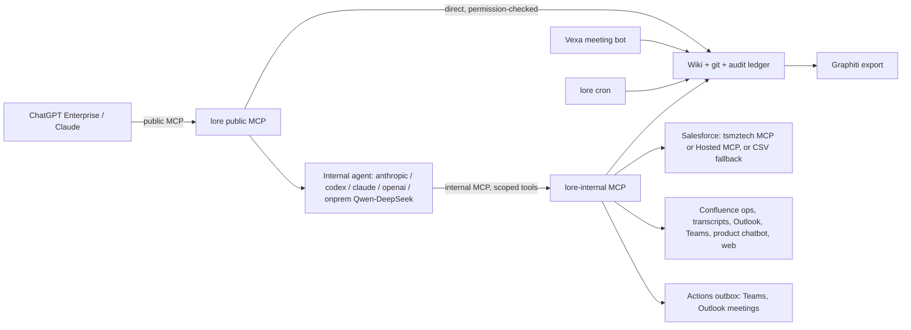

# Lore

Lore is an on-prem knowledge layer that gives Singtel's ChatGPT Enterprise a complete, cited picture of every
customer. It joins the CRM (Salesforce), meeting transcripts, Outlook email, Confluence ops reports, Teams ops threads,
the internal product chatbot and public company news into one append-only wiki per account, and serves it to ChatGPT
(or Claude, Cursor, Codex) through one MCP server.

Its niche: **the bridge from L1/L2 Ops to the account manager.** When a customer's engineer asks Ops for something a
Singtel product covers and the customer does not own, Lore restates it in plain language for the AM, names the
product, checks gates (fix open service issues first, respect consent), tells the AM on Teams, and logs every step.

> All data is synthetic (`../outputs/synthetic_crm_csv`). Products, prices and people are invented.

## Architecture



- **Public MCP** (`lore/public_mcp.py`): what ChatGPT connects to. Direct tools for transcripts, emails, ops reports,
  account pages, timelines, citations and the CRM (read plus governed update), fast deterministic insights, actions,
  and agent-backed tools (`lore_ask`, `lore_account_brief`, `lore_ingest`). The caller's identity limits which
  accounts are visible.
- **Internal agent** (`lore/agent/runner.py`): one interface, several model providers, set with `LORE_LLM`:
  `auto` (default: tries `LORE_LLM_CHAIN`, default `anthropic,codex`), `claude` (Claude Code headless, falls back to
  `anthropic` then `codex` on failure), `anthropic` (direct Messages API tool loop; honours `ANTHROPIC_BASE_URL`,
  `ANTHROPIC_API_KEY` / `ANTHROPIC_AUTH_TOKEN`, model from `LORE_ANTHROPIC_MODEL`), `codex` (`codex exec` with the
  ChatGPT login in `~/.codex`, model `LORE_CODEX_MODEL`), `openai`, or `onprem` (any OpenAI-compatible endpoint, e.g.
  Qwen or DeepSeek on vLLM or Ollama inside Singtel, so no customer data leaves the network). The provider actually
  used is reported, e.g. `[anthropic->codex, 28s, tools: ...]`.
- **Internal MCP** (`lore/internal_mcp.py`): granular tools with scopes. `read` agents cannot write; `write` adds
  append-only wiki tools and governed CRM updates; `actions` adds Teams and meeting proposals.
- **Wiki** (`lore/kb/store.py`, `knowledge-base/`): raw sources and timeline events are only ever added. Every fact
  cites `raw/...#Lnn`, carries an `epistemic_status`, and has a source rank (meeting > email > CRM / ops / AM note >
  calendar > press > research). Changes are new events that supersede old ones; contradictions are flagged with a
  winner. Every write is a git commit and an entry in a hash-chained audit ledger.

## Quick start

```bash
cd v2
uv sync
uv run python -m lore.kb.seed --reset   # build the wiki from the synthetic CRM export (~1,200 sources, ~1,800 facts)
uv run pytest -q                        # 52 tests
uv run python scripts/smoke_mcp.py      # starts both MCP servers and calls their tools
uv run python scripts/demo.py           # the ACC-0001 story through the public MCP (~3 s)
uv run python scripts/demo.py --agent   # plus agent Q&A, Vexa transcript ingest and a brief (needs a working model provider, see LORE_LLM)
```

`LORE_USER` sets who you are (default `OWN-002`, an account executive who owns 17 accounts including ACC-0001).

## Connect a client

**Claude Code / Claude Desktop / Cursor (stdio):**

```json
{"mcpServers": {"lore": {"command": "uv", "args": ["--directory", "/path/to/v2", "run", "lore", "serve"],
                         "env": {"LORE_USER": "OWN-002"}}}}
```

**ChatGPT Enterprise (streamable HTTP):**

```bash
uv run lore serve --http        # http://127.0.0.1:8848/mcp
```

ChatGPT needs a public HTTPS URL. In production, put Lore behind Singtel's gateway (for example IBM
mcp-context-forge) with SSO; the gateway passes the user as the `x-lore-user` header. For a demo:

```bash
scripts/public_tunnel.sh OWN-002   # prints https://<random>.app.lhr.life/mcp?user=OWN-002 and starts the server
```

In ChatGPT, add that URL as a custom connector with no authentication. `?user=` sets the Lore user, and access
scope still applies. The script uses a localhost.run SSH tunnel because some networks block Cloudflare Tunnel's port
7844. `cloudflared tunnel --url http://127.0.0.1:8848` also works where that port is open. Any tunnel hostname
must be listed in `LORE_PUBLIC_ALLOWED_HOSTS`, because the MCP SDK rejects non-localhost `Host` headers.

## Demo story (ACC-0001, Demo Asterforge Manufacturing)

1. `lore_who_to_call_this_week` ranks Asterforge first: an ops request for a product they lack, an expansion signal,
   and an open churn ticket.
2. `lore_ops_bridge`: the customer's Senior Network Engineer asked Ops for 24x7 security monitoring with one alert
   dashboard. In sales terms that is Managed Security Services, which they do not own. Gate:
   `service_recovery_first`, because ticket TKT-0003 is still open.
3. `lore_notify_am` sends the AM a Teams note (outbox `../outputs/lore-actions/teams/`).
4. `lore_conflicts`: the meeting said "first two branches live Feb 2027"; the press said "Q3 2027". The meeting wins.
5. `lore_timeline`: the CRM budget of S$209k was superseded by S$120k said on a call. Both stay in history.
6. `lore_account_map`: champion (the engineer), economic buyer (CFO), the IT Director's concerns, as Mermaid plus
   `../outputs/lore-maps/ACC-0001.html`.
7. `lore_product_assistant` asks the internal product chatbot which product fits.
8. `lore_schedule_meeting` proposes a meeting, drops do-not-contact people, warns about consent and the churn
   ticket; `lore_confirm_action` writes the `.ics` to the outbox and records a commitment in the wiki.
9. `lore_crm_update` changes the opportunity from ChatGPT: allowlisted fields only, own accounts only, a reason is
   required, and the change is mirrored into the wiki as a superseding fact.
10. With `--agent`: `lore_ask`, `lore_ingest` of a Vexa Teams transcript, and `lore_account_brief`.

## Scheduled jobs

```bash
uv run lore cron list
uv run lore cron run ops-bridge-scan --dry-run
uv run lore cron install      # prints crontab lines; does not install them
```

| Job | What it does |
| --- | --- |
| `ingest-inbox` | Files dropped in `../outputs/lore-inbox/` (markdown with front matter, or a Vexa `ACC-0001_*.json`) are stored and the ingest agent extracts cited facts. `--no-agent` stores only. |
| `ops-bridge-scan` | Sends the account owner one Teams note per new bridge item. |
| `company-watch` | Pulls new public company signals (press, tenders, job posts) into the wiki. |
| `weekly-rollup` | Rebuilds the weekly signals page. |
| `stale-check` | Flags facts with no support newer than 26 weeks. |
| `lint` | Checks sources, statuses and the audit ledger hash chain. |

## Salesforce

Offline by default (`LORE_CRM=csv`; the test suite always forces CSV). For a real org see
[docs/SALESFORCE_SETUP.md](docs/SALESFORCE_SETUP.md):

```bash
sf org login web --alias lore
uv run python -m lore.sf_load all          # deploy Lore_* fields + Lore_Access permission set, load all synthetic data (idempotent)
cat >> .env <<'ENV'
LORE_CRM=salesforce
LORE_SF_BACKEND=tsmztech
LORE_SF_ALIAS=lore
ENV
```

Verified against a live Developer Edition org: 10 products, 100 accounts, 300 contacts (with reports-to chains),
120 opportunities, 180 cases and 340 tasks. Reads, the public smoke test and a governed opportunity write all run
through the tsmztech MCP server.

Notes:
- Lore takes the access token from the `sf` CLI (`sf org auth show-access-token` when `sf org display` redacts it) and
  runs tsmztech in `Access_Token` mode, so no password or security token is stored.
- Do-not-contact is the custom field `Contact.Lore_Do_Not_Contact__c` (Developer orgs may not expose
  `HasOptedOutOfEmail` to the API).
- tsmztech's query tool returns no rows for aggregate SOQL such as `COUNT()`; use `sf data query` for counts.
- `LORE_SF_BACKEND=hosted` switches to the official Salesforce Hosted MCP Server (needs an External Client App).
## Governance

- **Least privilege:** account executives see their accounts, managers see their team's, Ops sees accounts they
  worked a ticket on. Scheduled jobs run as `job:<name>` and are attributed as such.
- **Consent:** do-not-contact and revoked-consent contacts are removed from invites; pending consent is flagged.
- **Customer-facing actions wait for a human.** Internal Teams notes go straight through.
- **CRM writes:** field allowlist, value validation, owner check, required reason, `var/crm_writes.jsonl`, and a
  wiki mirror so history survives even though Salesforce keeps only the latest value.
- **Audit:** every tool call goes to `var/tool_calls.jsonl`; every wiki write is a git commit plus a hash-chained
  `knowledge-base/audit/ledger.jsonl` entry (`uv run lore cron run lint` verifies the chain).
- **On-prem models:** `LORE_LLM=onprem LORE_ONPREM_BASE_URL=http://vllm.internal:8000/v1 LORE_ONPREM_MODEL=Qwen/Qwen2.5-32B-Instruct`.

## Open-source reuse

Vexa (meeting bot), Graphiti (temporal graph export), tsmztech/mcp-server-salesforce, the official MCP Python SDK,
the Karpathy LLM-wiki pattern, and IBM mcp-context-forge as the production gateway. Details in
[docs/OPEN_SOURCE.md](docs/OPEN_SOURCE.md).

## Layout

```
lore/public_mcp.py        MCP server ChatGPT connects to
lore/internal_mcp.py      scoped tools for the internal agent
lore/agent/runner.py      auto | claude | anthropic | codex | openai | onprem agent runtime
lore/kb/                  append-only wiki store, seeding, rollups
lore/connectors/          CRM (csv, Salesforce via tsmztech or Hosted MCP), mocked Singtel sources, Vexa
lore/insights.py          who to call, whitespace, ops bridge, account map, brief pack
lore/actions.py           Teams notes, meeting proposals and confirmation (mock Microsoft Graph outbox)
lore/crm_writes.py        governed CRM updates
lore/cli.py               `lore` command and cron jobs
lore/sf_load.py           Salesforce metadata deploy and data load
lore/export/              Graphiti export
playbook/                 prompts: meeting prep, ingest, weekly call plan, grow account, ops to sales
skills/lore-wiki/         rules every agent follows
salesforce/               SFDX metadata (Lore_* fields, Lore_Access permission set)
scripts/                  smoke test and demo
```
